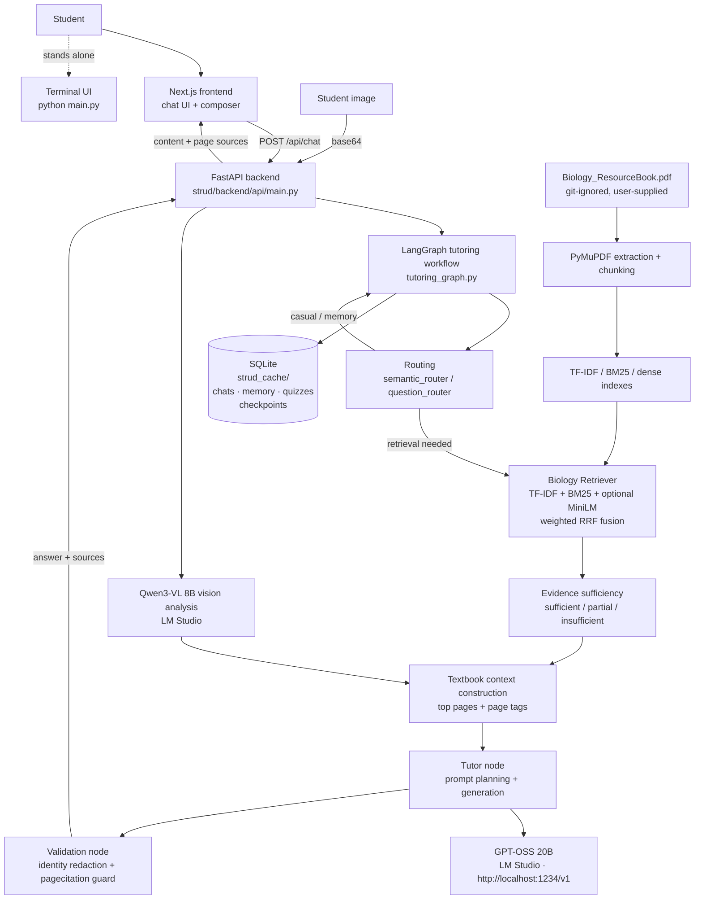

# Strud AI

**A retrieval-grounded AI study assistant for G.C.E. Advanced Level Biology, running entirely on local hardware.**

Strud pairs a local LLM (**GPT-OSS 20B** served by LM Studio) with a hybrid Biology-textbook retrieval engine (TF-IDF + BM25 (+ optional dense embeddings), weighted reciprocal-rank fusion, page-aware citations) and a silent answer-verification layer. Every answer is either grounded in specific pages of your own resource book — with the page numbers shown — or explicitly labelled as coming from general knowledge. Nothing is sent to any cloud AI service.

[](https://www.python.org/)
[](https://www.typescriptlang.org/)
[](https://nextjs.org/)
[](https://react.dev/)
[](https://tailwindcss.com/)
[](https://fastapi.tiangolo.com/)
[](https://langchain-ai.github.io/langgraph/)
[](https://lmstudio.ai/)

---

## Contents

1. [Public preview vs. the complete application](#1-public-preview-vs-the-complete-application)
2. [Key features](#2-key-features)
3. [Technology stack](#3-technology-stack)
4. [System architecture](#4-system-architecture)
5. [What happens when you ask a Biology question](#5-what-happens-when-you-ask-a-biology-question)
6. [Prerequisites and hardware](#6-prerequisites-and-hardware)
7. [Clone and install](#7-clone-and-install)
8. [Download and configure the models](#8-download-and-configure-the-models)
9. [Environment variables](#9-environment-variables)
10. [Start the complete application locally](#10-start-the-complete-application-locally)
11. [Biology resource ingestion and retrieval](#11-biology-resource-ingestion-and-retrieval)
12. [Testing and validation](#12-testing-and-validation)
13. [Troubleshooting](#13-troubleshooting)
14. [Repository structure](#14-repository-structure)
15. [Privacy and limitations](#15-privacy-and-limitations)
16. [Future improvements](#16-future-improvements)
17. [License and acknowledgements](#17-license-and-acknowledgements)

---

## 1. Public preview vs. the complete application

Strud AI ships in **two operating modes**:

| | Public preview (Vercel) | Complete application (your machine) |
|---|---|---|
| **What runs** | Next.js frontend only | Frontend + FastAPI backend + LM Studio + Biology RAG pipeline |
| **AI answers** | ❌ Not generated — the preview clearly says so | ✅ Real local inference |
| **Textbook retrieval / page citations** | ❌ | ✅ |
| **Chat persistence, memory, quizzes, projects** | Local browser only | SQLite-backed, survives restarts |
| **Setup** | None | This README (≈30 min first time) |

The public site at `strud-ai.vercel.app` is a **frontend-only demonstration**. It does not pretend a hosted backend exists: when a visitor sends a message, they get a polished notice explaining that live AI inference requires running Strud locally, with a link to this repository. No inference is simulated, no fake `localhost:8000` calls are made, and the browser console stays clean.

Running the complete application is exactly what the rest of this document covers.

## 2. Key features

All features below are implemented in the codebase (see [Section 12](#12-testing-and-validation) for the tests behind them).

- **Biology-focused question answering** with a routing layer (`semantic_router.py` + `question_router.py`) that decides per message whether the textbook is needed — casual conversation stays natural, subject questions get grounded.
- **Retrieval-augmented generation** against the official A-Level Biology resource book: page-preserving text extraction, page-tagged chunking (1,400 chars / 250 overlap), and page-cited answers rendered as a collapsible **Sources** chip.
- **Hybrid lexical retrieval**: TF-IDF (scikit-learn) + BM25 (hand-rolled sparse index), fused with **weighted Reciprocal Rank Fusion** (`RRF_K = 60`), with phrase boosting and neighbour-page expansion. Optional dense leg via `all-MiniLM-L6-v2` when `sentence-transformers` is installed — the pipeline degrades to sparse-only automatically.
- **Evidence sufficiency gate**: IDF-weighted term coverage, multi-leg agreement and supporting-page counts classify evidence as *sufficient / partial / insufficient* before the prompt is built. Insufficient evidence withholds the textbook context entirely, so the model cannot invent page citations.
- **Local LLM inference** through any OpenAI-compatible endpoint — models and endpoints live in config (`assistant_config.json` / `vision_config.json`), never in code.
- **Vision support** via **Qwen3-VL 8B** for textbook diagrams and student-uploaded images (PNG/JPEG/WebP ≤ 8 MB), gated by `vision_config.json`. Requires the vision model to be loaded in LM Studio; without it, text chat still works.
- **LangGraph tutoring workflow** with a SQLite checkpointer: per-chat conversation memory, persistent cross-chat memory (learned facts/preferences), structured quiz sessions with scores computed from stored records — never from the model's recollection.
- **Modern chat interface**: markdown rendering, chat search and grouping (Today / Yesterday / Previous 7 Days / Older), soft-delete **Recycle Bin** (restore / permanent delete / empty), image attachments, typing indicator, projects, loading and error states.
- **Prompt-injection defence in depth**: guard regexes, a trusted system prompt, and deterministic post-generation redaction of internal identity strings — *resistance, not a guarantee* (see [Section 15](#15-privacy-and-limitations)).

Not implemented (stated honestly): token streaming in the web UI, real authentication for multi-user deployment.

## 3. Technology stack

| Layer | Technologies |
|---|---|
| Frontend | Next.js 16 (App Router, Turbopack), React 19, TypeScript 5, Tailwind CSS v4, Motion, Lucide icons, react-markdown + remark-gfm |
| Backend | Python 3.10+, FastAPI, Uvicorn, Pydantic v2 |
| AI orchestration | LangChain 1.x + LangGraph 1.x (`ChatOpenAI` adapter over the local server, `SqliteSaver` checkpoints) |
| Local model runtime | [LM Studio](https://lmstudio.ai) exposing an OpenAI-compatible API at `http://localhost:1234/v1` |
| Models | `openai/gpt-oss-20b` (text), `qwen/qwen3-vl-8b` (vision) |
| Retrieval | scikit-learn (TF-IDF), hand-rolled BM25, optional `sentence-transformers/all-MiniLM-L6-v2` dense leg, weighted RRF fusion, PyMuPDF extraction |
| Persistence | SQLite via the standard library (`strud_cache/strud_memory_v3.db`, `strud_checkpoints.db`), git-ignored runtime cache |
| Testing | pytest, unittest, custom retrieval/grounding benchmarks, node markdown-rendering tests |

No cloud SDKs, no API keys, no vector-database service. The optional Supabase integration in the code is behind feature flags and is **not required** for the local workflow described here.

## 4. System architecture



**Component responsibilities**

- **Frontend** (`strud/frontend/`) — presentation + interaction only. It never loads a model and never computes Biology content; all AI capability funnels through the backend API client (`lib/api/`).
- **FastAPI adapter** (`strud/backend/api/main.py`) — thin HTTP boundary: request validation, routing to the LangGraph workflow, upload persistence, chat CRUD. Holds no AI logic.
- **Tutoring graph** (`strud/backend/tutoring_graph.py`) — typed LangGraph workflow handling chat turns, memory extraction, quiz routing and persistence.
- **Retriever** (`Science/Biology/biology_retriever.py`) — index build/load, hybrid search, fusion, grounding confidence, page-aware context.
- **LLM client** (`llm_client.py`) — OpenAI-compatible requests to LM Studio, availability checks, model/status reporting.
- **Local model server** (LM Studio) — hosts the GGUF/MLX builds of GPT-OSS 20B and Qwen3-VL 8B that you download yourself.

## 5. What happens when you ask a Biology question

Step by step, from the existing implementation:

1. **Submission.** The composer sends the text (and optional base64 image attachments) to `POST /api/chat`. The backend routes the turn into the tutoring workflow.
2. **Routing.** A lightweight LLM call classifies intent: casual chat → answered directly with conversation memory; study request, definition, mechanism → marked as needing the textbook (a rule-based router takes over if this call fails).
3. **Retrieval.** The retriever encodes the (normalised) question and runs the TF-IDF and BM25 legs — plus the dense leg when embeddings are installed — then fuses the ranked lists with weighted RRF, applies phrase boosts and expands to neighbouring textbook pages.
4. **Evidence sufficiency.** The fused pages are scored (IDF-weighted term coverage, agreement across retrieval legs, number of supporting chunks). *Insufficient* evidence means the textbook context never reaches the prompt.
5. **Prompt construction.** A tutor prompt is assembled from the answer plan (type, depth, tutoring mode), the student's profile/memory, and only usable textbook chunks, each tagged with its page number.
6. **Local inference.** The prompt goes to GPT-OSS 20B on `localhost:1234/v1` through the LangChain adapter. Images, when present, were already analysed by Qwen3-VL 8B and enter the same prompt as extracted concepts.
7. **Verification.** Before delivery, the draft is checked for relevance, evidence support, citation validity (orphan page numbers are stripped) and repetition; one silent internal revision is allowed.
8. **Delivery.** The answer plus its verified page list is persisted and returned to the frontend, which renders the text with a collapsible Sources chip ("Biology Resource Book — Page 67, 69–72"). Unsupported claims are rewritten as "not in the book" rather than cited.

**Why this differs from sending the question straight to the LLM:** the model is *constrained at generation time* to evidence that was retrieved, scored and validated — rather than trusted to recall syllabus-accurate content. A-Level answers are graded against the resource book's own wording and scope, which parametric memory cannot guarantee. The grounding gate and sufficiency thresholds are calibrated constants backed by benchmark scripts (`tests/benchmark_grounding.py`, `tests/benchmark_retrieval.py`), not vibes: at current settings the grounding benchmark measured 96% supported-question accuracy and 100% rejection of unsupported probes.

## 6. Prerequisites and hardware

| Requirement | Notes |
|---|---|
| **OS** | macOS, Linux or Windows 10/11 (frontend and backend are pure Python/Node; model runtime support is per the runtime vendor) |
| **Python** | 3.10 or newer (developed on 3.12+) |
| **Node.js** | 20+ with npm (a lockfile is provided) |
| **Git** | any recent version |
| **LM Studio** | current version, with its local server feature |
| **Disk** | ~2 GB for the repository + dependencies; **≈ 30–40 GB** for both models (see below); ≈ 200–400 MB for the textbook index |
| **Model downloads** | done manually by you — **never** pulled during install |

**Hardware is the real constraint.** Exact requirements depend on quantisation, context length and runtime, so treat the following as realistic guidance, not a spec sheet:

- **`openai/gpt-oss-20b`** — a 20B-class model. A machine with ~32 GB of unified memory/RAM (Apple-silicon Macs handle it well; equivalent VRAM/RAM headroom needed elsewhere) and a modern multi-core CPU/GPU gives comfortable generation. On smaller machines, choose a more heavily quantised build in LM Studio and accept lower quality/speed.
- **`qwen/qwen3-vl-8b`** — an 8B vision-language model; noticeably lighter (budget ~10–15 GB depending on quantisation). Machines that struggle with the 20B can often still run the 8B, but text answers need the 20B.

Check the size shown in LM Studio before downloading; the dense retrieval leg adds another ~500 MB of PyTorch + models if you install `sentence-transformers`.

## 7. Clone and install

```bash
git clone https://github.com/PyDeV1OpEr/Strud_AI.git
cd Strud_AI

# --- Python environment (backend + AI pipeline) ---
python3 -m venv .venv
source .venv/bin/activate            # Windows (PowerShell): .venv\Scripts\Activate.ps1
pip install -r requirements.txt -r strud/backend/requirements.txt

# Optional — dense retrieval leg (auto-detected; heavy PyTorch install):
# pip install sentence-transformers
```

The root `requirements.txt` covers the shared AI pipeline; `strud/backend/requirements.txt` covers the FastAPI layer. Both are needed.

```bash
# --- Frontend ---
cd strud/frontend
npm install
cd ../..

# --- Biology resource book ------------------
# The A-Level Biology resource PDF is copyrighted material and is NOT in
# the repository. Place YOUR OWN copy at:
#   Science/Biology/books/Biology_ResourceBook.pdf
mkdir -p Science/Biology/books
cp /path/to/your/Biology_ResourceBook.pdf Science/Biology/books/
```

The path is repository-relative, resolved from `PDF_FILE` in `config.py` (overridable only via the data directory, not a hardcoded machine path). If the file is missing, the backend starts, reports `textbookLoaded: false` with the expected path in `GET /api/health`, and chat answers say plainly that the textbook index is unavailable instead of producing citations.

## 8. Download and configure the models

Strud uses LM Studio's OpenAI-compatible server. One-time setup:

1. **Install LM Studio** from <https://lmstudio.ai> and open the app.
2. **Download the models** (search tab — type the exact IDs):

   | Search for | Model card | Typical size |
   |---|---|---|
   | `openai/gpt-oss-20b` | `openai/gpt-oss-20b` — text generation | ≈ 20–30 GB depending on quantisation |
   | `qwen/qwen3-vl-8b` | `qwen/qwen3-vl-8b` — vision-language | ≈ 8–12 GB depending on quantisation |

   Pick a quantisation that fits your hardware ([Section 6](#6-prerequisites-and-hardware)). **Do not** grab an MLX-specific or differently-named variant: the app must be pointed at the identifier LM Studio actually reports (next bullet), and `assistant_config.json` defaults to the ids above. Never rename models manually.

3. **Load the models and start the server**
   - Load **`openai/gpt-oss-20b`** (always required for chat answers).
   - Load **`qwen/qwen3-vl-8b`** only when you want diagram/image support.
   - Go to the **Developer / Local Server** tab → **Start Server**. Default endpoint: `http://localhost:1234/v1`.

4. **Verify connectivity**

   ```bash
   curl http://localhost:1234/v1/models
   # → {"data": [{"id": "openai/gpt-oss-20b", ...}, {"id": "qwen/qwen3-vl-8b", ...}]}
   ```

   Then point Strud at the **exact reported identifiers**:

   ```bash
   curl http://localhost:8000/api/health
   # → {"ok": true, "llmAvailable": true, "textbookLoaded": true,
   #     "retrievalMode": "tfidf_dense", "model": "openai/gpt-oss-20b"}
   ```

   `model` must match the id you loaded. If it differs, either update `assistant_config.json` → `"model": {"id": "..."}` (or set `LLM_MODEL_ID`) and restart the backend — mismatched ids are the most common cause of "model not found" errors, because LM Studio serves whichever ids are actually loaded.

**Differences that matter in the app**

| | GPT-OSS 20B | Qwen3-VL 8B |
|---|---|---|
| Role | Generates every text answer inside the tutoring graph | Analyses uploaded/diagram images into concepts that feed retrieval + generation |
| Loaded when | Always (chat is unusable without it) | Optional — `vision_config.json` enables it; absent it, text chat still works |
| Config keys | `assistant_config.json` (`model.id`, `model.base_url`), env `LLM_MODEL_ID` / `LLM_BASE_URL` | `vision_config.json` (`"enabled"`, `model`, `base_url`) |

Vision limitations, stated honestly: image input is implemented through this pipeline (upload → base64 → Qwen analysis → concept extraction); if the configured chat endpoint/model cannot handle the attached image types, the backend returns a clear error message — it will not silently drop the image or pretend the model "saw" it. The web UI restricts uploads to PNG/JPEG/WebP ≤ 8 MB.

Never paste any API key into source files — the local workflow needs none. If you later switch to a hosted OpenAI-compatible endpoint, keys belong in environment variables (`LLM_API_KEY`), never in the repository.

## 9. Environment variables

Inspect the real code: only these are read, and all are optional with sensible defaults.

| Variable | Where | Default | Required? | Purpose |
|---|---|---|---|---|
| `NEXT_PUBLIC_BACKEND_URL` | frontend `.env.local` | `http://localhost:8000` | yes (frontend) | Base URL of the FastAPI backend |
| `NEXT_PUBLIC_DEMO_MODE` | Vercel build env | unset (= `false`) | no | `true` builds the frontend-only public demo (demo notice, zero backend requests) |
| `LLM_MODEL_ID` / `LLM_BASE_URL` | backend | `openai/gpt-oss-20b` / `http://localhost:1234/v1` (from `assistant_config.json`) | no | Override model id / OpenAI-compatible endpoint (hosted-LLM option; unused locally) |
| `STRUD_DATA_DIR` | backend | `./strud_cache` (repo-relative) | no | Redirect all generated data (indexes, SQLite DBs, uploads) |
| `STRUD_ALLOWED_ORIGINS` | backend | loopback origins auto-allowed | no | Extra CORS origins, comma-separated (only_needed_if frontend runs on a non-loopback origin) |

Model/feature switches (`MODEL`, retrieval thresholds, `RETRIEVAL_MODE`, `VISION_*`) live in **config files** (`config.py`, `assistant_config.json`, `vision_config.json`), not environment files. No `.env` files are committed; `.env.local` (frontend) and secrets stay git-ignored. Example:

```env
# strud/frontend/.env.local
NEXT_PUBLIC_BACKEND_URL=http://localhost:8000
```

## 10. Start the complete application locally

Order matters. Each step needs its own terminal — every service stays open.

**Terminal 1 — model server**

Open LM Studio → Developer tab → **Start Server** with `openai/gpt-oss-20b` loaded. Keep the app open.

**Terminal 2 — FastAPI backend** (repository root; each shell, once per environment)

```bash
source .venv/bin/activate        # Windows: .venv\Scripts\Activate.ps1
.venv/bin/python -m uvicorn strud.backend.api.main:app --host 127.0.0.1 --port 8000
```

First start builds the textbook index if `strud_cache/` is empty (a few minutes; afterwards it loads from cache) and creates the SQLite databases and upload directory automatically.

```bash
# Windows uses the same venv activate shown above; the run command is:
#   .venv\Scripts\python -m uvicorn strud.backend.api.main:app --host 127.0.0.1 --port 8000
```

**Terminal 3 — Next.js frontend**

```bash
cd strud/frontend
npm run dev
```

**Then open** the URL Next.js prints (default `http://localhost:3000`).

**Verify everything is connected**

```bash
curl http://localhost:8000/api/health
# {"ok":true,"llmAvailable":true,"textbookLoaded":true, ...}
```

Type a Biology question in the UI. A grounded answer shows the green **Sources** chip with page numbers; the composer's spinner stops when the response or error arrives. Use `python main.py` (with the venv active) if you prefer the terminal UI over the web stack.

Ports already in use? Append `--port 8080` (backend) and update `NEXT_PUBLIC_BACKEND_URL` accordingly — `8000` (backend), `1234` (model server) and `3000` (frontend) must each be unique.

## 11. Biology resource ingestion and retrieval

**Input.** `Science/Biology/books/Biology_ResourceBook.pdf` (user-supplied; git-ignored). On startup, the pipeline computes a signature (name/size/mtime hash) for the current PDF — **if the PDF changes, the cached index invalidates automatically and is rebuilt on the next request.** No manual rebuild step exists; delete `strud_cache/` while the backend is stopped if you want a forced clean rebuild.

**Extraction and chunking.** PyMuPDF extracts each page's text (page numbers preserved). Text is chunked at ~1,400 characters with 250-character overlap, and every chunk remembers its source page.

**Indexing** (all cached under `strud_cache/`, built only from your local PDF):
- `chunks.pkl` / `metadata.json` — chunk + page metadata
- TF-IDF sparse matrix, hand-rolled BM25 sparse index
- optional dense vectors (`semantic_embeddings.npy`, all-MiniLM-L6-v2, only when `sentence-transformers` is installed; `AUTO_BUILD` on if the file is absent)
- persisted Qwen "visual chunks" for previously-analysed diagrams

**Retrieval at query time.** Each leg produces its own ranked list; the lists are fused with **weighted Reciprocal Rank Fusion** (`RRF_K = 60` — each source list's rank `r` contributes `weight / (60 + r)`, with TF-IDF, BM25 and dense legs weighted separately, plus phrase-boosted results and ±1-page neighbour expansion). Fused pages then pass the evidence-sufficiency gate described in [Section 5](#5-what-happens-when-you-ask-a-biology-question).

**Citations.** The answer's page list is validated against the pages actually retrieved (orphan citations are stripped), so "Source: page 67" always corresponds to a chunk the retriever found for *that* question.

**Missing resources fail loudly:**
- PDF absent → `GET /api/health` reports `textbookLoaded: false` **with `textbookHint` and `expectedTextbookPath`** naming exactly where to put the file; chat responses state that grounding is unavailable (no citations are invented).
- Index corrupt/empty → the same diagnostic points at checking the startup logs.

Do not commit the PDF, generated indexes or model weights; they are git-ignored on purpose.

## 12. Testing and validation

```bash
# Backend regression suites (offline; no LM Studio needed):
.venv/bin/python -m pytest strud/backend/test_chat_persistence.py \
                            strud/backend/test_response_formatting.py \
                            strud/backend/test_auth.py -q
.venv/bin/python tests/test_memory_and_quiz.py        # 34 checks
.venv/bin/python -m unittest tests/test_ai_control_center.py

# Retrieval/pipeline suites (need the built index; some need LM Studio):
.venv/bin/python tests/test_hybrid_retrieval.py
.venv/bin/python tests/benchmark_grounding.py         # measured grounding
.venv/bin/python tests/benchmark_retrieval.py         # retrieval quality

# Frontend:
cd strud/frontend
npx tsc --noEmit                                      # typecheck
npx eslint .                                          # lint
node --experimental-strip-types tests/markdown-rendering.mjs
npm run build                                         # production build + typecheck
```

## 13. Troubleshooting

| Symptom | What to check | Fix |
|---|---|---|
| `curl localhost:1234/v1/models` fails | LM Studio not running / server not started | Start the Server in the Developer tab; the endpoint is `http://localhost:1234/v1` |
| Chat replies "The AI engine isn't responding" | Backend started without LM Studio; `llmAvailable: false` in `GET /api/health` | Load `openai/gpt-oss-20b` in LM Studio, start the server, retry with the backend running |
| Health reports a different `model` than expected | Model id mismatch between `assistant_config.json` (`model.id`) and what LM Studio loaded | Copy the **exact id** from `GET /v1/models`; update `assistant_config.json` or set `LLM_MODEL_ID`, restart backend |
| "Model not found" / empty responses | Wrong identifier, MLX variant, or no model loaded | Load the exact model; avoid renamed/dup variants; re-check `/v1/models` |
| Frontend: connection refused on send | Backend (`uvicorn`) not running or crashed | Check Terminal 2; restart on port 8000 (or change `NEXT_PUBLIC_BACKEND_URL` if the port changed) |
| CORS errors in the browser console | Frontend on non-loopback origin (e.g. LAN IP) | Add that origin to `STRUD_ALLOWED_ORIGINS` and restart the backend; localhost forms are always allowed |
| Frontend points at the wrong API | `NEXT_PUBLIC_BACKEND_URL` missing or stale | Set it in `strud/frontend/.env.local`, then fully restart `npm run dev` (env changes need a scratch) |
| `textbookLoaded: false` + `textbookHint` mentions path | PDF absent | Copy your resource book to `Science/Biology/books/Biology_ResourceBook.pdf`; index builds on next backend start |
| Index stale / retrieval looks wrong | PDF was replaced but service stayed up | Restart the backend (signature change triggers a rebuild); confirm `chunk_count` in `GET /api/health` looks sensible |
| `pip install` fails on PyMuPDF/LangChain | Old Python or platform wheel gap | Use Python 3.10–3.12; `pip install --upgrade pip` first |
| `npm install` / `npm run dev` fails | Node 18-, npm cache issue | Node 20+; `rm -rf node_modules package-lock.json && npm install` |
| Port already in use | another dev server holds 3000/8000 | start on a free port and set `NEXT_PUBLIC_BACKEND_URL` (see §10) |
| Generation is very slow / model load fails | per §6 RAM/GPU headroom + long context | lower quantisation, shorter context, or a smaller model; the first message after load is always slowest (warm-up) |
| Image attachment errors | vision model not loaded or disabled, unsupported type | load `qwen/qwen3-vl-8b`, keep `vision_config.json` `"enabled": true`, use PNG/JPEG/WebP ≤ 8 MB |

## 14. Repository structure

```text
├── main.py                      # terminal UI entry point
├── config.py                    # models, retrieval thresholds, feature flags (repo-relative paths)
├── llm_client.py                # LM Studio / OpenAI-compatible client
├── semantic_router.py           # intent + needs_retrieval decision layer
├── question_router.py           # fast rule-based fallback router
├── answer_intelligence.py       # answer plans: type, depth, tutoring mode, memory
├── answer_verification.py       # silent verification + one internal revision
├── evidence_sufficiency.py      # post-retrieval "can this evidence answer it?"
├── injection_guard.py           # prompt-injection defence
├── assistant_identity.py        # system-prompt identity rules
├── assistant_config.json        # model + base URL (default GPT-OSS 20B @ LM Studio)
├── vision_config.json           # Qwen3-VL 8B toggle + ids
├── cli/                         # terminal UX (interface, renderer, input)
├── Science/Biology/             # biology_engine, biology_retriever (TF-IDF/BM25/RRF), vision pipeline
├── strud/                       # the web boundary
│   ├── README.md                # frontend/API contract docs
│   ├── backend/                 # FastAPI adapter + schemas
│   │   ├── api/main.py
│   │   ├── models/schemas.py
│   │   └── tutoring_graph.py, memory_store.py, auth.py, ...
│   └── frontend/                # Next.js chat application
│       ├── app/, components/, hooks/, lib/api/, types/
├── tests/                       # regression suites, grounding + retrieval benchmarks
├── experiments/                 # optional LoRA fine-tuning workflow (MLX, Apple Silicon)
├── Science/Biology/books/       # ← your Biology_ResourceBook.pdf goes here (git-ignored)
└── strud_cache/                 # generated runtime data (git-ignored, created automatically)
    ├── *.pkl / *.npy / metadata.json   # chunk + retrieval indexes
    ├── strud_memory_v3.db              # chats, messages, memory, quizzes, deletion state
    ├── strud_checkpoints.db            # LangGraph checkpoints
    └── uploads/                        # validated persisted chat images
```

## 15. Privacy and limitations

- **Local inference.** The LLM, embeddings and retrieval index run on the user's machine. No conversation leaves the machine during answering. Downloading dependencies/models and `pip`/`npm` setup traffic are the exceptions — the application is *local-first*, not verified air-gapped (OS-level network inspection would be required for that claim).
- **What is stored where.** Chats, titles, memory, quiz records, deletion state and attachment metadata live in SQLite under `strud_cache/`; uploaded images in `strud_cache/uploads/`; the PDF, indexes and model weights are git-ignored. The browser keeps `localStorage` as an *offline cache*, not the source of truth.
- **Model quality varies.** Answer quality and speed depend on the quantisation, your hardware and the current implementation. Strud is hallucination-*managed*, not hallucination-free: unsupported claims are caught by verification, but a clever model (or an adversarial, prompt-injected student) can still slip past — the guards are layered defence, not a guarantee (see `tests/test_intelligence_upgrade.py` and the Limitations section of the legacy docs).
- **Image input** needs both models loaded and is only as good as the vision pipeline's concept extraction.

## 16. Future improvements

Clearly future work, not current features:

1. **Token streaming** in the web UI (backend currently returns complete JSON per answer).
2. **Retrieval evaluation** — expand benchmark coverage + a small HTML eval report.
3. **Richer citations** — quoted page excerpts alongside page numbers, with click-through context.
4. **Expanded resources** — past papers and revision guides as additional indexed corpora.
5. **Authentication & multi-user** — authenticated subjects before exposing beyond loopback.
6. **More domains** — Physics/Chemistry on the same router/retriever framework.
7. **Semantic memory search** over stored user facts (currently recency-ordered into the prompt).

## 17. License and acknowledgements

- **Code:** personal educational project — no formal open-source license at this time; all rights reserved by the author ([@PyDeV1OpEr](https://github.com/PyDeV1OpEr)). You may read, run and fork it locally; do not redistribute.
- **Biology resource book** (`Biology_ResourceBook.pdf`): third-party copyrighted material, **never distributed with the repository**. Users must supply their own legally obtained copy. All rights remain with the publisher.
- **Model weights** (`openai/gpt-oss-20b`, `qwen/qwen3-vl-8b`): downloaded separately from their respective releases/licences; not redistributed here. Cite/obey each model's own licence terms.
- **Thanks** to the open-source ecosystem this stands on: FastAPI, LangChain/LangGraph, Next.js, React, Tailwind, scikit-learn, PyMuPDF, LM Studio, and the GPT-OSS/Qwen model teams.

---

*Built by [PyDeV1OpEr](https://github.com/PyDeV1OpEr) — a project about making an AI that teaches the way a good tutor does: grounded, honest, and patient.*
