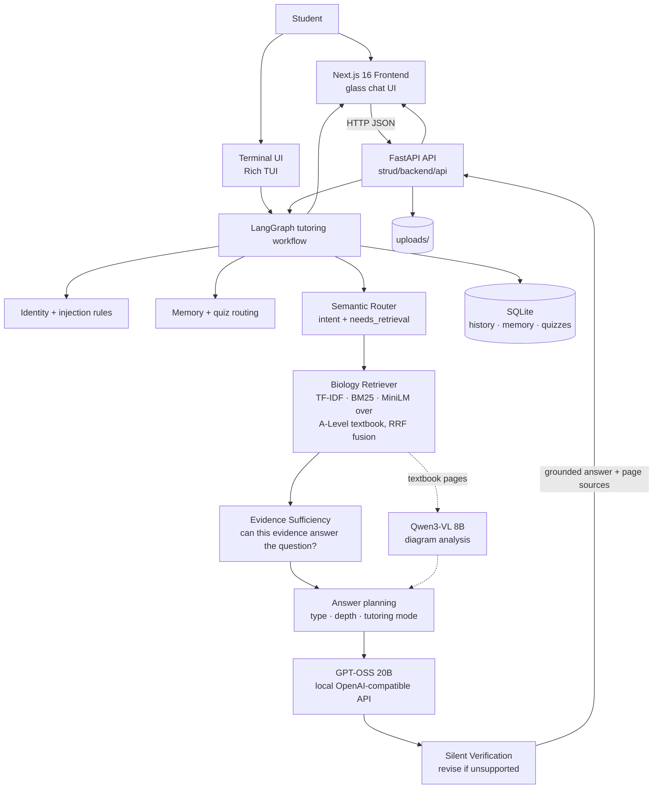

# Strud AI

**A retrieval-grounded AI study assistant for G.C.E. Advanced Level Biology, with a glassmorphism web interface built on Next.js and FastAPI.**

Strud is an end-to-end, privacy-first tutoring system. A local LLM (GPT-OSS 20B served by LM Studio) produces every answer; a hybrid retrieval engine grounds each Biology response in page-cited passages from the official A-Level resource book; an internal answer-intelligence layer shapes *how* each answer is taught; and a silent verification service checks every reply against retrieved evidence before the student sees it. The same pipeline powers a polished terminal UI and a modern web chat interface.

[](https://www.python.org/)
[](https://www.typescriptlang.org/)
[](https://developer.mozilla.org/en-US/docs/Web/JavaScript)
[](https://nextjs.org/)
[](https://react.dev/)
[](https://tailwindcss.com/)
[](https://fastapi.tiangolo.com/)
[](https://docs.langchain.com/)
[](https://langchain-ai.github.io/langgraph/)
[](https://www.sqlite.org/)
[](https://docs.pytest.org/)
[](https://lmstudio.ai/)

---

## Overview

- **Who it is for** — Sri Lankan G.C.E. A-Level Biology students who need explanations grounded in their own resource books, not generic internet answers.
- **What it is** — A full-stack application: a Next.js chat frontend, a FastAPI adapter, and a Python AI pipeline (retrieval, routing, planning, verification, vision) that runs entirely on local hardware.
- **Why grounding matters** — An educational assistant should be able to say *which textbook page* an answer comes from — and *when it cannot* find support, it should say so instead of inventing content. Strud retrieves evidence first, decides whether that evidence is sufficient, and only then allows page citations.
- **Local by design** — Questions never leave the machine: the LLM, embeddings, and retrieval index are all local. No cloud AI APIs.

Strud is under active development. It is not hallucination-free — it is *hallucination-managed*: unsupported claims are caught by verification before delivery, and ungrounded answers are explicitly labelled as coming from general knowledge.

---

## Architecture



The web API and the terminal application share the tutoring components, while the web API currently invokes the typed LangGraph workflow directly. The chat flow is: context loading → routing → optional retrieval → evidence evaluation → answer planning → local model generation → validation → durable persistence → response with sources.

---

## Tech Stack

| Layer | Technologies |
|---|---|
| Frontend | Next.js 16 (App Router, Turbopack), React 19, TypeScript, Tailwind CSS v4, Motion (`motion/react`), Lucide icons, `react-markdown` + `remark-gfm` |
| Backend | Python 3.10+, FastAPI, Uvicorn, Pydantic v2 |
| LLM | `openai/gpt-oss-20b` served through [LM Studio](https://lmstudio.ai) at `http://localhost:1234/v1` (OpenAI-compatible API) |
| Vision | `qwen/qwen3-vl-8b` via LM Studio (enabled in `vision_config.json`; used for textbook diagrams and student-uploaded images) |
| Retrieval | scikit-learn TF-IDF (sparse) · hand-rolled BM25 (sparse lexical, Phase 1) · `sentence-transformers/all-MiniLM-L6-v2` dense embeddings · Reciprocal Rank Fusion (`RRF_K=60`, weighted per leg) · phrase boosting · neighbour-page expansion |
| Persistence | SQLite via Python `sqlite3` (`strud_cache/strud_memory_v3.db`) for chats, messages, user memory, quiz records, soft-deletion state, and attachment metadata; durable image files in `strud_cache/uploads/`; retrieval indexes in `strud_cache/`. Browser `localStorage` remains an offline cache. |
| Tooling | ESLint 9, Rich (TUI), PyMuPDF (PDF processing), MLX (fine-tuning, Apple Silicon) |

---

## The AI / RAG Pipeline

```text
Student question
      ↓
Injection guard          — prompt-injection attempts never reach the model
      ↓
Semantic router          — one lightweight LLM call classifies intent:
                            casual chat vs. Biology question vs. study request,
                            decides whether retrieval is needed, normalises
                            slang/misspellings for the retriever
      ↓
Knowledge retrieval      — TF-IDF + BM25 + MiniLM dense legs, fused with RRF,
                            phrase-boosted, neighbour pages expanded
      ↓
Evidence sufficiency     — IDF-weighted term coverage, multi-leg agreement,
                            supporting-page count and chunk relevance decide:
                            sufficient → partial → insufficient
      ↓
Context construction     — only usable textbook pages enter the prompt
                            (insufficient evidence → withheld entirely)
      ↓
Answer planning          — answer type, depth (short → deep dive),
                            tutoring mode (explain / quiz / correction), memory
      ↓
GPT-OSS 20B              — grounded generation in TEXTBOOK / MIXED / GENERAL mode
      ↓
Silent verification      — relevance, evidence support, coverage, citation
                            validity, repetition; one internal revision allowed
      ↓
Grounded answer + real page numbers  or  honest "not in the book" response
```

Retrieval is deliberately a **tool, not a default**: the router decides per message whether the textbook is needed, so casual conversation still feels natural while subject questions stay grounded.

### Why this design

- A-Level answers are graded against the resource book; answers must match *its* wording and scope, which generic LLM memory cannot guarantee.
- The grounding gate (first filter) and evidence-sufficiency layer (post-retrieval judge) are measured, not vibes: thresholds in `config.py` were recalibrated against `tests/benchmark_grounding.py` (supported-question accuracy 96%, unsupported-probe rejection 100% at current settings).
- Verification runs *silently* — students never see JSON, scores, or revision churn; they see either a cited answer or an honest gap statement.

This reduces — but does not eliminate — reliance on unsupported model memory. Every answer states its grounding status.

---

## The Biology Resource

`Science/Biology/books/Biology_ResourceBook.pdf` (git-ignored; supply your own copy) is the knowledge source.

```text
PDF (PyMuPDF)
  → text extraction, page-preserving
  → chunking (1,400 chars, 250 overlap, page-tagged)
  → indexing: TF-IDF matrix · BM25 index · MiniLM embeddings (all cached in strud_cache/)
  → RRF retrieval against the question query
  → top pages → textbook context (max 5 pages, 2 chunks/page)
  → page-aware citations in the final answer
```

The Web UI renders these as a collapsible **Sources** chip ("Biology Resource Book — Page 67, 69–72"). Sources are *only* shown when the backend reports the answer as grounded; fabricated citations are impossible by construction (the adapter forwards the retriever's page set, gated by verification).

---

## Web Interface

`strud/frontend/` — a dark-first glassmorphism chat application.

**Implemented**

- Chat interface with markdown-rendered assistant replies
- New chat, chat switching, chat search, soft-delete with confirmation dialog
- Server-backed chat history grouped Today / Yesterday / Previous 7 Days / Older
- Recently Deleted / Recycle Bin: preview, restore, permanent delete, and empty-bin confirmation
- Image attachments (PNG/JPEG/WebP ≤ 8 MB) with thumbnail preview and durable upload storage
- Collapsible page-cited Sources
- Typing indicator, copy-response action, friendly error states
- Responsive layout: floating sidebar on desktop, animated drawer on mobile
- Reduced-motion support, labelled controls, keyboard-operable menus
- First-message title generation with durable SQLite title metadata

**Not implemented (yet)**: streaming responses and authentication.

```text
frontend/                          backend/
  UI + user interaction              AI + retrieval + business logic
        ↓                                  ↑
        └──────── API client (lib/api) ────┘
```

The frontend never loads a model and never computes Biology content; it renders the responses and durable chat records returned by the FastAPI API. Browser storage is retained only as an offline cache.

---

## Image Support

Fully implemented through the pipeline's vision path:

```text
Image attached in UI
  → base64 in the chat request
  → FastAPI validates and writes a UUID-named file to strud_cache/uploads/
  → the tutoring graph receives the persisted attachment reference
  → Qwen3-VL 8B analyses the image + extracts Biology concepts
  → question + concepts → textbook retrieval
  → GPT-OSS 20B composes the grounded answer
  → sources reflect the pages actually retrieved
```

Vision is gated by `vision_config.json` (`"enabled": true`) and requires the `qwen/qwen3-vl-8b` model to be loaded in LM Studio. Without it, text chat and retrieval still work. Persisted image records remain associated with their original messages and are served through `/api/uploads/{filename}`.

---

## API

| Method | Endpoint | Purpose |
| ------ | -------- | ------- |
| GET  | `/api/health` | Backend status: LLM reachable, textbook index loaded, active model |
| POST | `/api/chat`   | Send a question `{chatId, userId, title?, message, attachments?}` → `{messageId, content, sources?}` |
| POST | `/api/title`  | Derive a short chat title `{chatId, message}` → `{title}` |
| PATCH | `/api/chats/{chat_id}/title` | Persist a chat title `{userId, title}` in SQLite |
| GET  | `/api/chats` | List active chats with durable messages and attachment metadata |
| GET  | `/api/chats/deleted` | List chats in Recently Deleted |
| DELETE | `/api/chats/{chat_id}` | Move one active chat to the Recycle Bin |
| POST | `/api/chats/{chat_id}/restore` | Restore a deleted chat with its original ID |
| DELETE | `/api/chats/{chat_id}/permanent` | Permanently delete one deleted chat and owned uploads |
| DELETE | `/api/chats/deleted/all` | Permanently delete all chats currently in the bin |
| GET  | `/api/uploads/{filename}` | Serve a validated persisted image upload |

Chat CRUD and Recycle Bin operations are server-backed. The frontend keeps the API boundary in `strud/frontend/lib/api/chats.ts` and falls back to local browser state only when the backend is unavailable.

---

## Project Structure

```text
├── main.py                      # TUI entry point
├── config.py                    # models, retrieval thresholds, feature flags
├── llm_client.py                # LM Studio client (chat, availability, vision model)
├── semantic_router.py           # intent/domain decision layer
├── answer_intelligence.py       # answer plans: type, depth, tutoring mode, memory
├── answer_verification.py       # silent verification + internal revision
├── evidence_sufficiency.py      # post-retrieval "can this evidence answer it?"
├── injection_guard.py           # prompt-injection defence
├── question_router.py           # fast rule-based fallback router
├── cli/                         # terminal UI (interface, rendering, input)
├── Science/Biology/             # biology_engine, hybrid retriever, vision pipeline
├── strud/
│   ├── README.md                # web-boundary docs (API contract, state model)
│   ├── backend/                 # FastAPI adapter + Pydantic schemas
│   │   ├── api/main.py
│   │   └── models/schemas.py
│   └── frontend/                # Next.js chat application
│       ├── app/                 # layout + page
│       ├── components/          # chat/, composer/, sidebar/, profile/, ui/
│       ├── hooks/use-chats.tsx  # app state (external store + useSyncExternalStore)
│       ├── lib/                 # api client, store, grouping, title
│       ├── styles/              # design tokens, glass utilities, markdown styles
│       └── types/               # shared TS contracts
├── tests/                       # unit tests + grounding/retrieval benchmarks
├── experiments/                 # LoRA behaviour fine-tuning (see below)
└── strud_cache/                 # git-ignored runtime data (created automatically)
    ├── strud_memory_v3.db       # SQLite chats, memory, quizzes, deletion state
    ├── strud_checkpoints.db     # LangGraph checkpoints
    └── uploads/                 # validated persisted chat images
```

---

## Local Setup

### Prerequisites

- Python 3.10+
- Node.js 20+
- [LM Studio](https://lmstudio.ai) with **`openai/gpt-oss-20b`** loaded and its server started on `http://localhost:1234/v1` (also load `qwen/qwen3-vl-8b` for image support)
- Your A-Level Biology resource-book PDF at `Science/Biology/books/Biology_ResourceBook.pdf`

### Python environment (backend + pipeline)

```bash
git clone https://github.com/PyDeV1OpEr/Strud_AI.git
cd Strud_AI
python -m venv .venv
source .venv/bin/activate
pip install -r requirements.txt -r strud/backend/requirements.txt
# optional — dense retrieval leg (auto-detected if installed; the
# pipeline degrades to sparse-only if it's absent):
pip install sentence-transformers        # pulls torch; heavy install
```

### Frontend

```bash
cd strud/frontend
npm install
```

---

## Running the Application

Start services in this order (each in its own terminal):

**Terminal 1 — model server**
Start LM Studio's local server with `openai/gpt-oss-20b` loaded (port 1234). Retrieval and startup will not need it, but every answer does.

**Terminal 2 — FastAPI backend** (from the repository root)
```bash
source .venv/bin/activate
.venv/bin/python -m uvicorn strud.backend.api.main:app --host 127.0.0.1 --port 8000
```
First start builds the textbook index if `strud_cache/` is empty (a few minutes; afterwards it loads from cache). It also creates the SQLite database and upload directory automatically. `GET /api/health` returns `{"ok": true, "llmAvailable": true, "textbookLoaded": true}` when everything is connected.

**Terminal 3 — Next.js frontend**
```bash
cd strud/frontend
npm run dev
```
Open the printed URL (default `http://localhost:3000`).

**Or the terminal UI instead of the web stack:**
```bash
source .venv/bin/activate
python main.py
```

---

## Environment Variables

| Variable | Where | Default | Purpose |
|---|---|---|---|
| `NEXT_PUBLIC_BACKEND_URL` | frontend (`strud/frontend/.env.local`) | `http://localhost:8000` | Base URL of the FastAPI adapter |

No other variables are required. No API keys exist anywhere in the project — the LLM is local. The model/feature switches (`MODEL`, `VISION_*`, retrieval thresholds, `RETRIEVAL_MODE`) live in `config.py`, `assistant_config.json` and `vision_config.json`, not in environment files. No `.env` files are committed.

### Persistence and migrations

The backend uses standard-library SQLite and performs additive schema setup on startup. Existing `strud_cache/strud_memory_v3.db` files are migrated without deleting conversations: chat metadata is backfilled, then `deleted_at` and attachment metadata columns are added when absent. Chats moved to Recently Deleted retain their original IDs, messages, titles, and image references until permanent deletion. Permanent deletion removes only the deleted chat and its UUID-owned upload files; user-level memory remains intact.

For a clean development environment, it is safe to remove the generated `strud_cache/` directory while the backend is stopped; the textbook indexes and databases will be rebuilt. Do not commit that directory.

---

## Frontend Design Notes

- Dark interface built from layered glass surfaces (translucent panels + blur), tuned for readable long-form study content.
- ChatGPT-style conversational structure — message list, composer, collapsible sources — developed independently with Tailwind and Motion rather than a UI kit; the small `components/ui/primitives.tsx` set (Button/Dialog/Toast) is dependency-free in the shadcn/ui style.
- Motion provides entrance/exit animations for messages, drawer, dialogs and typing states; all respect `prefers-reduced-motion`.
- Responsive: ≥ `md` shows the docked glass sidebar; below it becomes an animated drawer.
- History grouping, search filtering and scroll anchoring are pure client logic; the AI contract stays server-side.

---

## Current Status

**Under active development.**

### Implemented
- Web chat UI (chat lifecycle, search, grouping, delete-confirm, image attachments, markdown, sources, error states)
- TUI with themed rendering and slash commands (`/status`, `/debug`, `/image`, `/vision`, `/clear`)
- Semantic router → retrieval → evidence sufficiency → answer planning → GPT-OSS 20B → silent verification
- Hybrid TF-IDF + BM25 + MiniLM retrieval with RRF; measured grounding benchmarks
- Qwen3-VL 8B diagram analysis (textbook pages *and* student images)
- FastAPI web adapter driving the pipeline headlessly, per-chat conversation memory
- LoRA behaviour fine-tuning pipeline for GPT-OSS 20B (MLX, Apple Silicon)
- Prompt-injection guard, identity/capability handling, bounded conversation memory

### In progress
- Iterating on the behaviour fine-tuning loop (dataset, benchmark scoring, results in `experiments/results/`)

### Planned
- Token streaming in the web UI (backend currently returns complete JSON per answer)
- Additional A-Level domains (Physics, Chemistry) on the same router/retriever framework
- Production deployment story (packaging, process supervision)

---

## Roadmap

1. **Streaming** — switch the adapter to SSE once `llm_client.chat` gains a streaming mode; frontend changes are confined to `lib/api/chat.ts`.
2. **Retrieval evaluation** — expand `tests/benchmark_retrieval.py` coverage and add a small HTML eval report.
3. **Richer citations** — quoted page excerpts alongside page numbers, with click-through context.
4. **Expanded resources** — past papers and revision guides as additional indexed corpora.
5. **Authentication & multi-user** — replace the stable local browser identity with authenticated subjects before exposing the service beyond loopback.

---

## Engineering Notes

- **Separation of concerns.** Frontend = presentation + interaction. FastAPI = HTTP boundary + sessions. `cli/interface.py` = orchestration. Retrieval/verification/vision = intelligence. The web adapter holds no AI logic; swapping GPT-OSS 20B for another OpenAI-compatible model is a one-line config change.
- **Shared tutoring layers.** The terminal and web paths share routing, retrieval, verification, vision, and memory components; the web API invokes the LangGraph workflow directly.
- **Per-chat state.** Each chat id is scoped by `user_id` in SQLite and LangGraph checkpoints. Messages, title metadata, soft-deletion state, and attachment references survive backend restarts.
- **Measured grounding.** Grounding thresholds are calibrated constants with benchmark scripts behind them — see `tests/benchmark_grounding.py` and the rationale comments in `config.py`.
- **Fallback chain.** If the semantic router's LLM call fails, a rule-based router takes over; if a retrieval leg is unavailable (e.g. embeddings not built), the pipeline degrades to the remaining legs instead of failing.

---

## Fine-Tuning Experiments

`experiments/` contains a reproducible LoRA behaviour-tuning workflow for `openai/gpt-oss-20b` on Apple Silicon (MLX backend):

- `experiments/scripts/build_strud_dataset.py` — curated, behaviour-only ChatML SFT dataset
- `experiments/configs/strud_gptoss20b.yaml` — training config (LoRA r=16, cosine schedule, gradient checkpointing)
- `experiments/evals/strud_benchmark.py` — behavioural benchmark (casual handling, exam-panic empathy, explanation depth, meta-leak checks)
- `experiments/results/` — baseline vs. tuned scores

Design decision: **facts live in the retriever, behaviour lives in the fine-tune.** The SFT data deliberately avoids teaching biology content so the tuned model never "memorises" textbook facts that would bypass grounding.

---

## Testing

```bash
# offline regression suites (no textbook index or LM Studio needed):
.venv/bin/python tests/test_memory_and_quiz.py            # tutoring graph structure + quiz logic
.venv/bin/python -m pytest strud/backend/test_chat_persistence.py      # titles, attachments, Recycle Bin
.venv/bin/python -m pytest strud/backend/test_response_formatting.py   # answer-formatting contract

# suites that need the built index and/or LM Studio:
python tests/test_hybrid_retrieval.py        # TF-IDF + BM25 + dense fusion
python tests/test_conversation_architecture.py
python tests/test_vision_pipeline.py
python tests/test_intelligence_upgrade.py    # negotiation/injection hardening
python tests/benchmark_grounding.py          # grounding thresholds
python tests/benchmark_retrieval.py          # retrieval quality
```

Frontend: `cd strud/frontend && npm run lint && npm run build && npm run test:markdown`.

The backend regression suites use `pytest`, which is already included in `strud/backend/requirements.txt`.

---

## Privacy by Design

- The LLM, embeddings and retrieval index run locally — no conversation ever leaves the machine.
- Textbook PDFs, model checkpoints and index caches are git-ignored and never uploaded.
- Chat history, titles, memory, quiz records, deletion state, and attachment metadata are stored in SQLite; uploaded images live in the git-ignored `strud_cache/uploads/` directory. Browser `localStorage` is only an offline cache.
- The injection guard and verification layer operate entirely offline.

---

## Development Notes

Personal educational project — no formal open-source license; all rights reserved by the author. Third-party textbook PDFs remain the property of their publishers and are never distributed with this repository.

If you want to work on the web boundary, read `strud/README.md` first (API contract, session model, frontend architecture). Keep the frontend model-agnostic: model/retrieval decisions belong on the Python side.

---

*Built by [PyDeV1OpEr](https://github.com/PyDeV1OpEr) — a project about making an AI that teaches the way a good tutor does: grounded, honest, and patient.*
